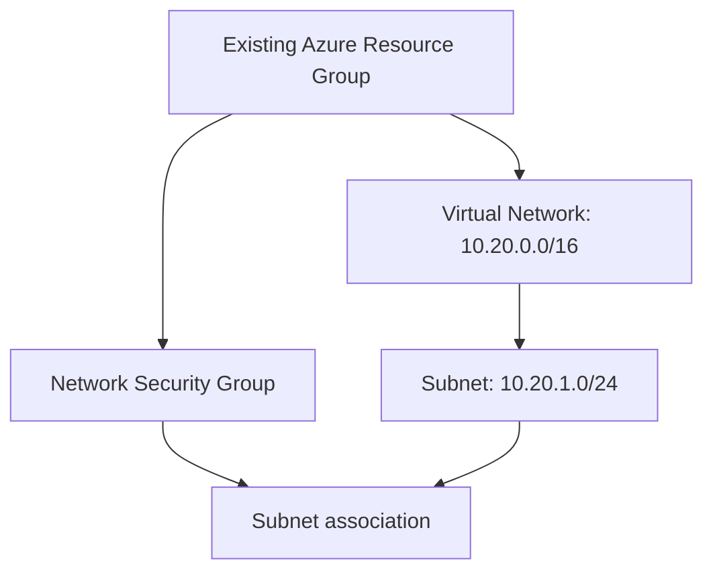

# CloudForge — Azure Network Foundation with Terraform

Provision a small Azure network foundation inside a **pre-existing lab Resource Group**:
- Virtual Network
- Subnet
- Network Security Group
- Subnet-to-NSG association

This project intentionally does not create a Resource Group because many training labs pre-provision one and grant permissions only inside that scope.

## Architecture



## Prerequisites
- Terraform 1.5+
- Azure CLI
- Azure subscription and a Resource Group where your identity has permissions to read the group and create/read VNet, subnet and NSG resources.
- Required Azure resource providers available in the subscription (or handled by the lab administrator).

## 1. Authenticate
```bash
az login
az account show
```
If multiple subscriptions are available, select the lab subscription:
```bash
az account set --subscription "<SUBSCRIPTION_ID>"
```

## 2. Configure the existing Resource Group
Copy the example file:
```bash
cp terraform.tfvars.example terraform.tfvars
```
On Windows PowerShell:
```powershell
Copy-Item terraform.tfvars.example terraform.tfvars
```
Edit `terraform.tfvars` and enter the exact Resource Group name supplied by your lab:
```hcl
resource_group_name = "YOUR_EXISTING_LAB_RESOURCE_GROUP"
location            = "eastus"
```
Do not commit `terraform.tfvars` if it contains environment-specific details.

## 3. Initialize, validate and plan
```bash
terraform fmt -recursive
terraform init
terraform validate
terraform plan
```
If the lab provides a non-default location, set it in `terraform.tfvars`.

## 4. Apply (only when permissions are available)
```bash
terraform apply
```
Review the plan and type `yes` only if the resources and scope are correct.

## 5. Verify and clean up
```bash
az network vnet list --resource-group "<YOUR_RG>" -o table
az network nsg list --resource-group "<YOUR_RG>" -o table
terraform destroy
```
Destroy removes resources managed by this Terraform configuration. Review the destroy plan carefully. It should not delete the pre-existing Resource Group.

## Files
- `main.tf`: provider, existing Resource Group data source, VNet, subnet, NSG and association.
- `variables.tf`: input variables.
- `outputs.tf`: useful resource IDs and address ranges.
- `terraform.tfvars.example`: sample input values.
- `.github/workflows/terraform-check.yml`: automated formatting, initialization and validation.

## GitHub Actions
The workflow checks formatting, initializes Terraform without a backend, and validates configuration. It does not deploy to Azure and does not need Azure credentials. This is deliberate: never store Azure secrets in source code. A future enhancement can add an authenticated plan/apply workflow using workload identity federation (OIDC) and protected GitHub environments.

## Common errors
- **403 AuthorizationFailed:** the signed-in identity lacks the required action at the Resource Group/subscription scope. Correct Terraform syntax cannot fix RBAC. Ask the lab provider/admin to grant the required permissions or use a lab that supports Terraform deployments.
- **ResourceGroupNotFound:** check the exact lab Resource Group name and active subscription.
- **Provider registration error:** the lab may restrict provider registration. `resource_provider_registrations = "none"` avoids Terraform attempting automatic registration, but the resource provider still needs to be available.
- **Address space conflict:** choose a non-overlapping VNet/subnet range approved for your environment.

## Interview explanation (60–90 seconds)
"I used Terraform to define a repeatable Azure network foundation. Instead of creating a Resource Group, I read the lab-provided Resource Group through a data source, because the lab owns that boundary. Terraform provisions a VNet, subnet and Network Security Group, then associates the NSG with the subnet. I separated inputs into variables and exposed resource IDs and address ranges as outputs. I added a GitHub Actions workflow to enforce formatting and validate the configuration on changes. Before applying, I review the plan; state tracks the resources Terraform manages. I also understand that deployment requires Azure RBAC permissions at the relevant scope."

## Interview questions
1. **What is IaC?** Defining infrastructure in machine-readable files so it can be reviewed, versioned and provisioned consistently.
2. **Resource vs data source?** A resource is managed by Terraform; a data source reads an existing object.
3. **What is Terraform state?** A mapping between configuration and real infrastructure, used to track managed objects and calculate changes.
4. **What does `terraform plan` do?** Shows proposed changes without applying them.
5. **What does `terraform apply` do?** Executes the approved operations and updates state.
6. **Why associate an NSG with a subnet?** It applies network security rules to traffic entering/leaving resources in that subnet.
7. **Why not create the Resource Group?** The lab pre-provisions it and may restrict permissions to that scope.
8. **What causes 403?** Azure authenticated the identity but authorization denied the requested action at that scope.
9. **How would you improve this?** Add reusable modules, remote state with locking, OIDC for CI, policy/security checks, environment-specific variables and a protected approval step.

## Evidence checklist
- [ ] `terraform fmt -recursive` completes.
- [ ] `terraform validate` succeeds.
- [ ] `terraform plan` shows the intended VNet, subnet, NSG and association.
- [ ] Apply succeeds in an authorized Azure environment, if available.
- [ ] Capture a screenshot of the plan and/or Azure resources.
